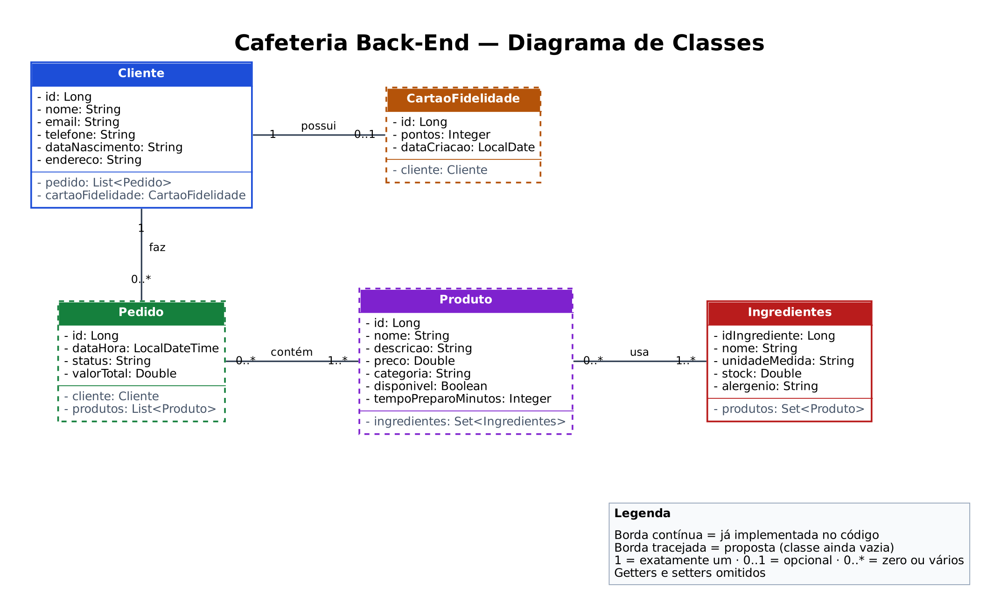

# cafeteria-back-end

Projeto final da cadeira de Programação Orientada a Objetos.

API da cafeteria feita com **Spring Boot**, organizada em camadas (Controller → Service → Repository → Model).

---

## 🧩 Diagrama de Classes



> ℹ️ **Legenda:** classes com borda **contínua** já estão implementadas no código (`Cliente` e `Ingredientes`). Classes com borda **tracejada** são uma proposta, pois ainda estão vazias, e devem ser validadas pelo grupo. O código-fonte do diagrama está em [`docs/diagrama-cafeteria.dot`](docs/diagrama-cafeteria.dot).

| Classe | Papel no sistema |
| --- | --- |
| `Cliente` | Pessoa que faz pedidos |
| `Pedido` | Compra feita por um cliente, com um ou mais produtos |
| `Produto` | Item do cardápio |
| `Ingredientes` | Insumos usados no preparo dos produtos |
| `CartaoFidelidade` | Pontos acumulados pelo cliente |

---

## 📁 Estrutura do projeto

```text
src/main/java/com/example/demo/
├── controller/   # Endpoints da API
├── service/      # Regras de negócio
├── repository/   # Acesso ao banco de dados
└── model/        # Entidades (Cliente, Pedido, Produto, Ingredientes, CartaoFidelidade)
```
